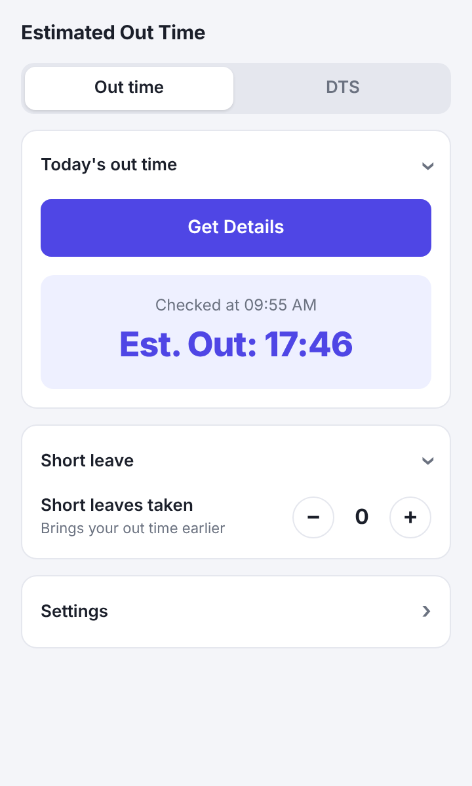
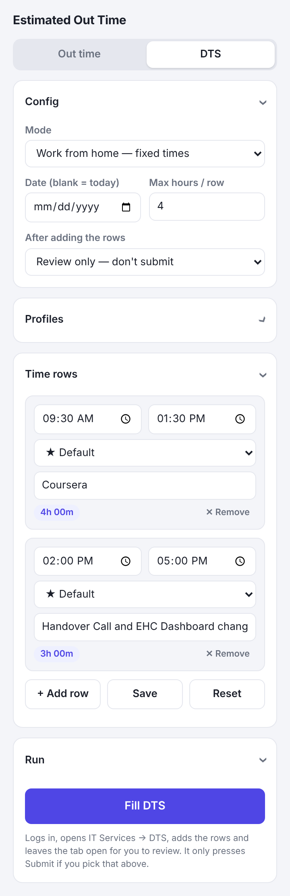
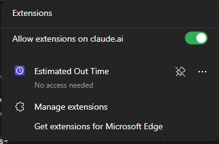
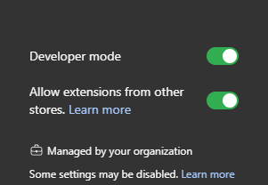
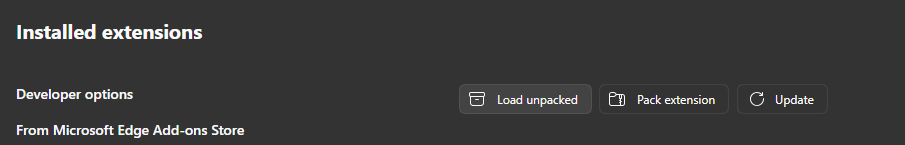
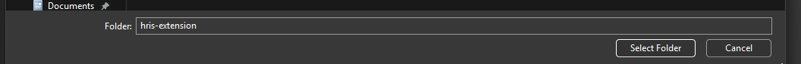
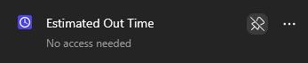

# ⏱️ Estimated Out Time

A small Chrome / Edge extension for the Yamaha HRIS that does two jobs for you:

| | |
|---|---|
| **🕔 Out time** | Logs into HRIS in the background and tells you your in-time and **when you can leave**, with short leaves taken into account. |
| **📝 DTS filling** | Logs in, opens **IT Services → DTS**, and fills your Daily Time Sheet rows (with per-row dropdown profiles) so you don't have to. |

<p align="center">
  
  &nbsp;&nbsp;
  
</p>

---

## 🚀 Quick start

1. [Get the code](#1-get-the-code)
2. [Load it into your browser](#2-load-it-into-your-browser)
3. [Pin it](#3-pin-it-to-the-toolbar)
4. [Save your login](#4-save-your-hris-login)
5. Use it: [Out time](#-using-out-time) or [DTS filling](#-using-dts-filling)

---

## 1. Get the code

Pick **one** of these.

### Option A — Download the ZIP (no Git needed)

1. Open <https://github.com/morpheus-30/hris-extension>
2. Click the green **Code** button → **Download ZIP**
   (or go straight to <https://github.com/morpheus-30/hris-extension/archive/refs/heads/main.zip>).
3. **Unzip** it somewhere permanent, for example `Documents`. You'll get a folder called `hris-extension-main`.

> ⚠️ Don't delete or move this folder later. The browser loads the extension *from* it.

### Option B — Clone with Git

```bash
git clone https://github.com/morpheus-30/hris-extension.git
```

To update later:

```bash
cd hris-extension
git pull
```

Then press the **reload** ⟳ button on the extension's card (see step 2).

---

## 2. Load it into your browser

Works in **Microsoft Edge** and **Google Chrome**.

**1. Open the extensions page.** Click the puzzle-piece icon and choose **Manage extensions**
(or type `edge://extensions` / `chrome://extensions` in the address bar).



**2. Turn on Developer mode** (toggle on the left side in Edge, top-right in Chrome).



**3. Click "Load unpacked".**



**4. Select the extension folder** — the folder that directly contains `manifest.json`
(`hris-extension` if you cloned, or the unzipped `hris-extension-main`), then click **Select Folder**.



You should now see **Estimated Out Time** in your extensions list. 🎉

> **Updating?** After a `git pull` or a new download, click the **⟳ reload** button on the
> extension's card in the extensions page.
>
> **Notification permission:** the first time you load a version that includes notifications, the
> browser may ask you to approve it. That's expected.

---

## 3. Pin it to the toolbar

So it's one click away:

1. Click the 🧩 puzzle icon in the toolbar.
2. Click the **pin** icon next to **Estimated Out Time**.



---

## 4. Save your HRIS login

You only do this once.

1. Click the extension icon.
2. On the **Out time** tab, open **Settings**.
3. Enter your HRIS **User Id** and **Password** under **HRIS login** and click **Save**.

🔒 Your login is stored **only in your browser's local extension storage**. It isn't in this repo, isn't
synced to your Google/Microsoft account, and is only typed into the HRIS login form. It is *not*
encrypted, so don't use the extension on a shared computer profile.

---

## 🕔 Using Out time

1. Open the **Out time** tab and click **Get Details**.
2. The extension logs in, in a hidden tab, reads today's punch, closes its tabs, and shows:
   - **Est. Out** — your in-time plus the required work duration, or
   - **already clocked out at …** if you have punched out.
3. You also get a **desktop notification** with the result, so it still shows if the popup closed.
4. Took a short leave? Press **+** under **Short leave** and the out time moves earlier.

**Settings** (Out time → Settings):

| Setting | What it does |
|---|---|
| Required work duration | Hours you must work, `HH:MM`. Default `08:30`. |
| Short leave length | Minutes one short leave is worth. Default `50`. |
| Notifications | Turn the result notification on or off. |

On the HRIS attendance calendar itself you'll also see a small **Est. Out** badge on today's cell.

---

## 📝 Using DTS filling

Open the **DTS** tab. Every section can be collapsed, and the popup remembers what you closed.

### Config

| Setting | Meaning |
|---|---|
| **Mode** | **Work from home** — rows use plain custom times. **Office** — rows can start at your system in-time or out-time, follow the previous row, or have a set length. |
| **Date** | Leave blank for today, or pick a day to back-fill. |
| **Max hours / row** | No single row can be longer than this (default 4). |
| **After adding the rows** | **Review only** (default), or **Auto-click Submit** if the form has a Submit button. |

### Profiles

A **profile** is a saved set of dropdown choices: Project, Module, Type of activity, Activity code & desc, and Status
(*Work In progress* or *Completed*). Text is matched by "contains", ignoring case.

- Make as many as you like: **New**, **Duplicate**, **Delete**, **Make default**.
- The **★ default** profile is what new rows use.
- Your old single set of dropdown settings is kept as a profile called **Default**.

### Time rows

Each row has a **From**, a **To**, a **Profile** and a **Comment**.

- In **Work from home** mode, From and To are plain times.
- In **Office** mode each side also has a dropdown:

  | From | To |
  |---|---|
  | Custom time | Custom time |
  | System in-time | System out-time |
  | After previous row (+ gap in minutes) | Length (hours after From) |

- The badge on each row shows its length; it turns red if a row is too long, or From is not before To.
- Rows can't overlap. **+ Add row** suggests the next slot for you.

> Typical office day: row 1 = *System in-time* → *Length 4h*; row 2 = *After previous (30 min)* → *Length 4h*.

### Run it

1. Click **Save** (optional — **Fill DTS** also saves).
2. Click **Fill DTS** and leave the browser open for about a minute.
3. The extension logs in, opens **IT Services → DTS**, sets the date, adds each row, and **leaves the DTS tab open and focused**.
4. A notification tells you how many entries were added.
5. **Check the entries** in the DTS tab, then submit as you normally would. By default the extension never presses Submit for you.

---

## 🧰 Troubleshooting

| Problem | Try this |
|---|---|
| "Save your User Id and Password first" | Add them under **Out time → Settings → HRIS login**. |
| First **Get Details** after loading does nothing | Click it once more. The first run can wake the extension up. |
| "Couldn't find the login form / IT Services link" | HRIS may have changed its page. Open an issue with a screenshot. |
| "No punch found for today yet" | You haven't punched in yet, or HRIS hasn't updated. |
| DTS error about a missing in-time/out-time | You used *System in-time/out-time* but the form has none for that date. Use a custom time. |
| "No … option found for Project/Module…" | Fix the **profile** text so it matches an option in the dropdown. |
| Nothing happens after an update | Reload the extension (⟳ on its card) and reopen the popup. |

Want to see what it's doing? On the extensions page click **service worker** under *Inspect views*
and watch the `[GetDetails]` logs.

---

## 📁 What's in the folder

```
manifest.json     extension definition (Manifest V3)
background.js     the automation: login, navigate, scrape, fill the DTS form
popup.html/js     the popup UI (Out time + DTS tabs)
dts-common.js     shared DTS config, validation and time maths
content.js        adds the "Est. Out" badge to the HRIS calendar page
styles.css        badge styles
docs/img/         screenshots used by this guide
```
